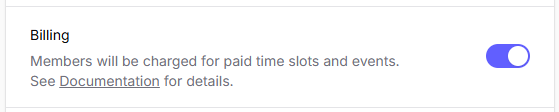
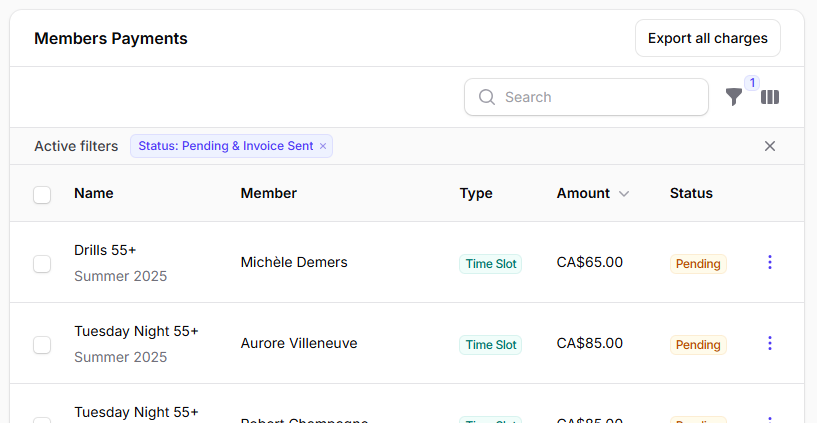
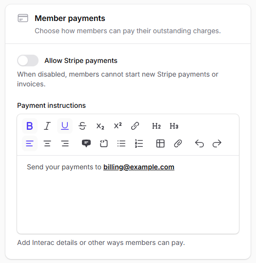
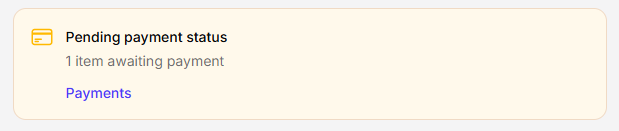
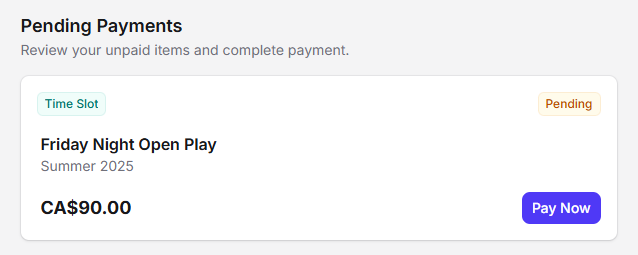

# Billing

PickleTime can track charges for your members with or without Stripe. Stripe is optional: if your club does not want to use Stripe, members can pay you by another method.

!!! info "Feature Toggle"

    The Billing feature can be enabled or disabled at any time from the admin panel, under **Setup -> Features**.

    

## Stripe-less Billing

You can still track member charges without connecting Stripe. When you receive a payment, you can mark it as paid from the Billing page in the admin panel. For example, you can record payments received by Interac or cash.

To disable Stripe, turn off this toggle. You can also specify payment instructions, these will be shown on the members payments page.

## Memberships

You can also setup a club monthly/yearly membership for your members. Membership billing is fully integrated, and charges can be paid through Stripe or recorded as paid manually when you receive payment by another method.

## Members Pending Payments

When a member has a pending charge, this message is shown on his home page.

Members can see their pending charges and see a history of their payments. If Stripe payments are disabled, the **Pay Now** button will be hidden.

